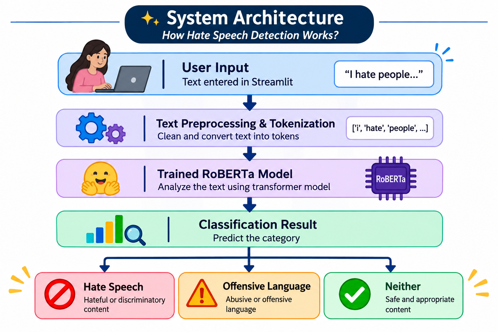
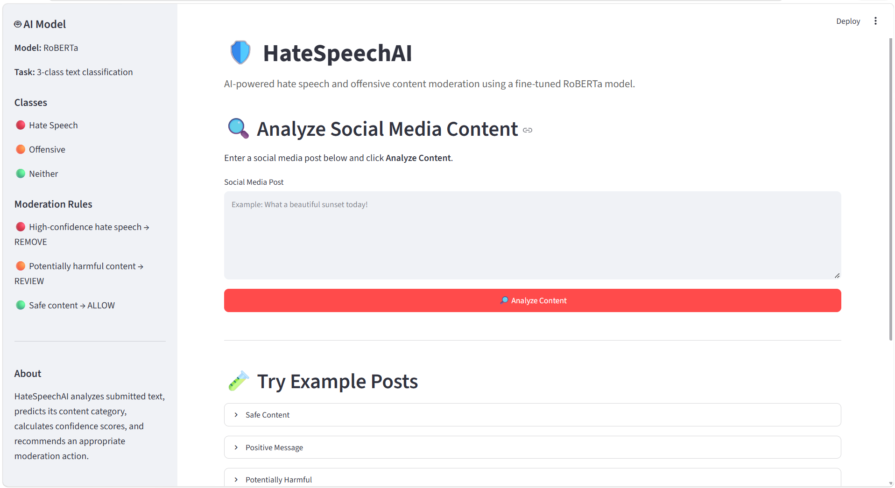

# Hate Speech Detection and Content Moderation

## Project Overview
An AI-powered Hate Speech Detection and Content Moderation System using NLP and the RoBERTa transformer model.

The project aims to identify potentially hateful or offensive text and support content moderation.

## Key Features

- **Three-Class Text Classification:** Classifies text into Hate Speech, Offensive Language, and Neither.
- **RoBERTa-Based Detection:** Uses a transformer-based NLP model to analyze text.
- **Content Moderation:** Helps identify potentially harmful and offensive text.
- **Interactive Web Interface:** Allows users to enter text and view prediction results.
- **Automated Prediction:** Displays the predicted category for the submitted text.

## System Architecture

The system follows this workflow:

1. **User Input:** The user enters text through the Streamlit interface.
2. **Text Preprocessing:** The input text is prepared for model processing.
3. **Tokenization:** The tokenizer converts the text into tokens that RoBERTa can understand.
4. **RoBERTa Model:** The trained model analyzes the text and predicts its category.
5. **Classification:** The text is classified into one of three categories:
   - Hate Speech
   - Offensive Language
   - Neither
6. **Result Display:** The predicted category is displayed on the application interface.

## System Architecture Diagram

## Sample Predictions

| Input Text                           | Predicted Category |
| ------------------------------------ | ------------------ |
| "I hate people from that community." | Hate Speech        |
| "You are so stupid!"                 | Offensive Language |
| "Have a wonderful day!"              | Neither            |

## Technologies Used
- Python
- NLP
- RoBERTa
- Transformers
- PyTorch
- Streamlit (if used in the application)

## Project Structure
- app/ – Application and moderation code
- colab/ – Model training notebook
- requirements.txt – Python dependencies

## Model Performance
- Accuracy: 89.19%
- Macro F1-score: 76.28%

*Reported experimental results; refer to the final evaluation notebook for details.*

## Trained Model
The trained model files are not included in this repository because of their size.

## Installation

1. Clone this repository.
2. Install dependencies:

pip install -r requirements.txt

3. Download or provide the trained model files separately.
4. Configure the model path before running the application.

## Application Preview

## Author

Sharmila Shaik
